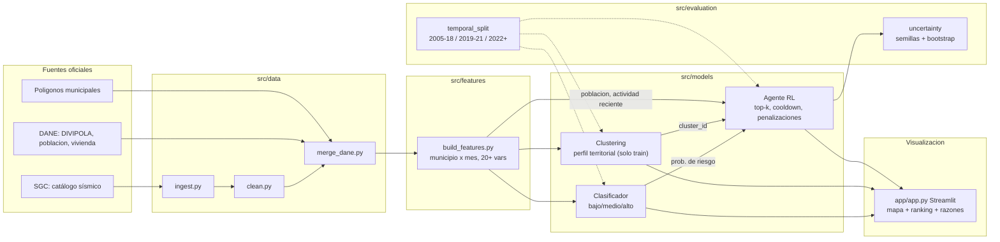

# Arquitectura (borrador Fase 0)

> Vale 15 pts en Medio y es parte de "Flujo y trazabilidad" en Avanzado. Exportar a `docs/arquitectura.png`
> (p. ej. pegando el bloque en https://mermaid.live) antes de las 12:00.

## Flujo de reproducibilidad
`config.yaml` (semillas, fechas, umbrales) → `src/` → `data/processed/dataset.parquet` → `artifacts/` → `app/`.
Notebooks solo narran y leen resultados de `artifacts/`.
